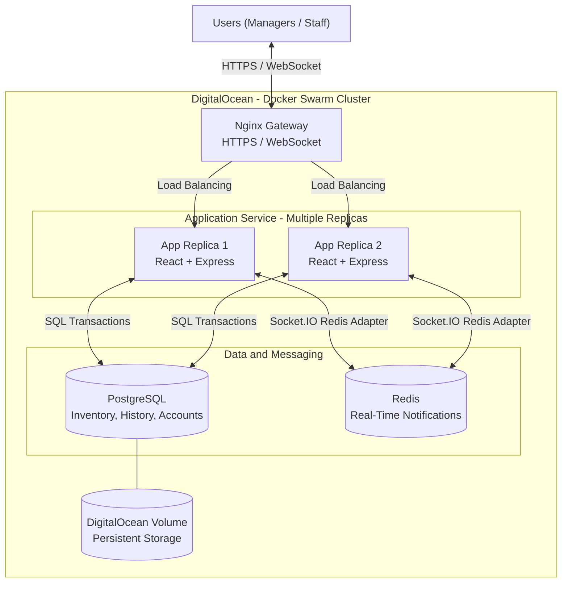

# Project Proposal: Cloud Inventory Manager

**Team members:** Justin Zhang, Pete Chen, Yutau Fu, Zavi Jawaid

## 1. Motivation

Many small organizations, such as small shops and food banks, track physical inventory with a shared spreadsheet. This works until several people update stock at the same time. Counts tend to drift, nobody knows who removed what or why, and items run out.

We have two groups of users in mind. **Managers** decide what is stocked, where it is kept and when to reorder. **Staff or volunteers** receive and hand out items day to day. Both need to trust that the number on the screen matches the shelf.

The existing options sit at two opposite ends. Spreadsheets are free and familiar but have no meaningful permissions and no reliable change history. Commercial inventory systems solve these problems but are usually too expensive and complex or heavy for a group of a dozen people. We see room for a small, focused tool that keeps an accurate shared record, shows changes as they happen, and never loses its history.

The problem also fits the course well: inventory is stateful by nature, so concurrency, persistence and recovery are core requirements of the application itself.

## 2. Objectives, Architecture, and Key Features

### 2.1 Objectives

1. Ensure that the provided shared view is accurate in how much of each product is at each location.
2. Provide a traceable history for every stock change: who, when and why.
3. Keep stock correct when several users act at once, with no negative stock and no lost updates.
4. Run the system as a replicated, monitored service on DigitalOcean whose data survives restarts and redeployments.

### 2.2 Core Features

- **Accounts and roles.** Individual logins with a Manager or Staff role. Staff handle daily stock actions; Managers also manage products, locations, accounts, thresholds and corrections. Permissions are enforced on the backend.
- **Products and locations.** Products have a unique SKU (alphanumeric code), name, category and description, and stock is tracked per product per location. Products are archived, not deleted, so their history is kept.
- **Stock operations.** Receive, issue and transfer stock; Managers can also make corrections with a required reason. Operations that would make stock negative are rejected.
- **Movement history.** Every change is treated as a new entry. Mistakes are fixed with a correction (new entry), not by editing an old entry.
- **Search and dashboard.** Filter by name, SKU, category, location and stock status, with a dashboard of low-stock and out-of-stock items.
- **Live updates.** Changes by one user appear for others without refreshing.

A CSV export is a nice-to-have if time allows.

### 2.3 Planned Architecture

The system has four main parts:

- **Nginx gateway:** the public entry point, handling HTTPS and forwarding both normal requests and WebSocket connections.
- **Application service:** an Express backend serving a small React frontend. It runs as multiple replicas and holds all business logic and permission checks.
- **PostgreSQL:** the single source of truth. Each stock operation runs in a transaction, so a transfer updates both locations and both history entries, or nothing at all.
- **Redis:** used only to pass "inventory changed" notifications between replicas. It stores no inventory data.

When stock changes, the server sends a small notification and clients re-fetch data from the API. This keeps the database as the only place quantities live, so a missed message cannot leave a client showing wrong numbers for long.

### 2.4 Use of Required Course Technologies

**Docker and Docker Compose.** The frontend and backend are built into one application image; PostgreSQL, Redis and Nginx run in their own containers. Locally, one Compose command starts the whole stack with a local database volume.

**PostgreSQL and persistent storage.** We will run PostgreSQL ourselves rather than use a managed database. Its data will live on a DigitalOcean Volume attached to one Droplet, with the database container placed on that node. Our main check is to replace the database container and confirm all data is still there.

**Deployment provider.** We chose DigitalOcean over Fly.io because Droplets, Volumes and the monitoring dashboards map directly onto course material, Swarm runs on plain Droplets without extra layers, and Spaces gives us a place for backups.

**Orchestration.** We plan to use Docker Swarm, starting with two Droplets (one manager, one worker) and at least two application replicas, relying on Swarm's load balancing and replacement of failed containers. We chose Swarm over Kubernetes because we are more comfortable with Compose, leaving more time for application logic and testing, at the cost of less exposure to the wider orchestration ecosystem.

**Monitoring and observability.** DigitalOcean's metrics agent will run on every Droplet, with dashboards and alerts for CPU, memory and disk. We will add health and readiness endpoints (readiness checks database access) and structured logs for requests and stock operations.
### 2.5 Advanced Features

We are committing to two advanced features and treating two more as stretch goals.

**Committed:**

1. **Real-time updates.** Socket.IO with a Redis adapter, so changes reach every connected user regardless of which replica they are on. Clients re-sync after reconnecting in case they missed a notification. Demo: two users on different replicas see the same change appear.
2. **Security enhancements.** Hashed passwords; login sessions stored in PostgreSQL so all replicas share them; role checks on every protected route and on WebSocket connections; HTTPS; production credentials supplied as Docker Swarm secrets; database and Redis kept off the public network.

**Potential additional features, in priority order:**

3. **Backup and recovery.** A scheduled `pg_dump` uploaded to a private Spaces bucket, plus a tested restore into a separate database.
4. **CI/CD.** GitHub Actions running tests and building the image on pull requests, with automated deployment if time allows.

Which stretch goals we complete depends on how the core work goes. We would rather finish two features properly than four partially.

### 2.6 Key Design Decisions and Trade-offs

- **History is append-only.** This makes it trustworthy and easier to reason about, at the cost of mistakes staying visible as correction entries.
- **Concurrency is handled in the database.** We plan to use transactions and row-level locks on inventory rows, so correctness does not depend on the number of replicas. We still need to test exactly how conflicts are reported to users.
- **The database is a single instance.** Replicating PostgreSQL is out of scope. The database node, gateway and Swarm manager are therefore single points of failure, and our high-availability claims are limited to the application tier.
- **Redis is the one extra service,** needed only because several replicas must share real-time notifications.

### 2.7 Scope and Feasibility

The core is a fairly standard web application. The real effort goes into correctness under concurrency, durable storage and a clean replicated deployment, not a large number of screens. We deliberately left out purchase orders, suppliers, barcode scanning, multi-organization support and analytics beyond the dashboard; this would be too broad for the scope of this project.

With four members and about four weeks, we believe the core features plus two advanced features are achievable, with the stretch goals using any extra time.

## 3. Project Plan and Team Responsibilities

This plan reflects our current intentions. Dates and ownership will likely shift as we learn more, especially once we start deploying. We will track tasks in GitHub Issues and revisit the plan at weekly check-ins.

### 3.1 Development Stages

| Period | Focus |
| --- | --- |
| Nov 2–9 | Repository setup, agree on schema and API, minimal app in Compose. Set up an early Swarm cluster so deployment issues show up early. |
| Nov 10–17 | Core features: auth, roles, products, locations, stock operations, history. Deploy to Swarm with a volume-backed database; basic monitoring. |
| Nov 18–24 | Real-time updates and security hardening. Concurrency and failure testing. Demo ready for the presentation. |
| Nov 25–Dec 5 | Stretch goals and bug fixes. Final testing, report, `ai-session.md` and video. |

### 3.2 Tentative Division of Work

All four members contributed to this proposal. For development, we split the work by system area so each member owns a coherent part from start to finish. This split is tentative: we will rebalance it at check-ins if one area turns out larger than expected, and each member also supports one other area so no part depends on a single person.

| Member | Owns | Supports |
| --- | --- | --- |
| Pete Chen | Database schema and migrations; stock operations (transactions, locking, transfers); concurrency and rollback tests | Backend API |
| Justin Zhang | Backend API structure; authentication, sessions and role checks; security features (HTTPS, secrets, network exposure) | Deployment |
| Yutao Fu | React frontend (inventory, history, dashboard, management pages); real-time updates on client and server | API testing |
| Zavi Jawaid | Dockerfiles and Compose; Swarm cluster, volume and DigitalOcean setup; monitoring and alerts; backup and CI/CD stretch goals | Stock logic testing |

Shared work, such as end-to-end testing, the final report, `ai-session.md`, the presentation and the video demo, will be split evenly closer to each deadline.

### 3.3 Integration Approach

We will agree on the API and schema in week one so frontend and backend work can run in parallel. Everyone uses the same Compose setup, work is merged through reviewed pull requests, and we redeploy to the cluster weekly rather than only near the deadline.

### 3.4 Dependencies and Risks

- **Stock logic is a bottleneck.** Most features depend on it and the schema, so these need to stabilize early.
- **Real-time updates depend on deployment.** Redis and the gateway must be configured correctly across replicas, and we do not yet know how much work that will take.
- **Volume placement.** A volume attaches to one Droplet at a time, so the database is pinned to one node and the Swarm configuration must respect that.
- **Scope.** If we fall behind, we will drop stretch goals before compromising the core.

## 4. Initial Team Reasoning and AI-Assisted Exploration

### 4.1 Initial Team Reasoning

**Problem framing.** Before deciding on inventory management, we had a few different ideas. One was a room and equipment booking system for clubs or labs, where we would need to prevent double-bookings. Another was an event ticketing system with QR codes for check-in. We also talked about StudySync, a platform where students could assign tasks, track progress, and see what their teammates had finished.

All of these seemed like good options, but we ended up choosing inventory management. The booking and ticketing systems had interesting concurrency problems, but also required extra scheduling or ticket validation logic. StudySync was more relatable to us as students, but we thought it might take more time to build the frontend. Inventory management felt like a better balance between development time and the cloud computing concepts we wanted to demonstrate.

**Initial technical hypotheses.** At first, we thought of inventory management as a simple CRUD application where each product had a stock quantity stored in PostgreSQL. We planned to use React and Express for the application and considered Docker Swarm for deployment since we were already familiar with Docker Compose. We also thought WebSockets could handle real-time inventory updates.

**Open questions.** We still had some questions, especially about what would happen if two users tried to remove the same item at the same time. We also weren't sure whether inventory history should be editable, how real-time updates would work across multiple replicas, or how DigitalOcean Volumes would work with Docker Swarm.

### 4.2 Exploration and Evaluation

As we discussed the project further, we realized that inventory management was more than just updating stock numbers. We needed to track where items were stored, who changed the stock, and why. We also needed to make sure two users couldn't accidentally remove more items than were available. This led us to include stock movement history, PostgreSQL transactions, and row-level locking.

We used ChatGPT to help organize our ideas and explore different technical approaches. One suggestion was to use Socket.IO with Redis to send inventory updates across multiple backend replicas. We thought this made sense since users connected to different replicas should still receive the same updates. We decided to use Redis for notifications while keeping PostgreSQL as the source of truth for inventory data.

However, we didn't follow every suggestion. Some features, like advanced handling of repeated requests and implementing four advanced features, seemed too much for our timeline. We decided to focus on real-time updates and security enhancements, while keeping backups and CI/CD as stretch goals.

Overall, our original idea was to build a simple inventory website. After comparing different projects and looking more closely at the technical challenges, we decided to focus more on data consistency, persistent storage, and cloud deployment rather than adding too many features.
