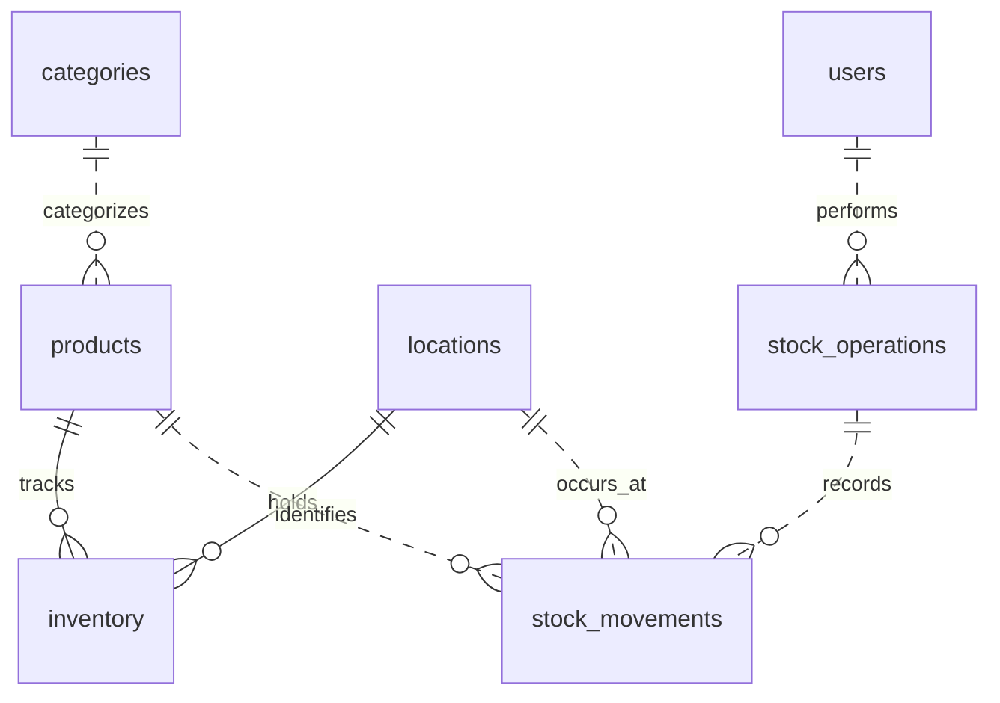

# Database schema

The Cloud Inventory Manager uses PostgreSQL to track stock by product and location. It contains eight application tables and one migration bookkeeping table.

**NOTE FOR FUTURE MIGRATION (e.g. modifications to the schema): label each version in the format "XXX_..." for conveniience.**

## Overview

| Table | What one row represents |
| --- | --- |
| [`users`](#users) | An account that can sign in and act on stock. |
| [`sessions`](#sessions) | A stored login session shared across app replicas. |
| [`categories`](#categories) | A category that products can share. |
| [`products`](#products) | A product identified by a unique SKU. |
| [`locations`](#locations) | A place where stock is kept. |
| [`inventory`](#inventory) | The current stock balance for one product at one location. |
| [`stock_operations`](#stock_operations) | A request to receive, issue, transfer, or correct stock. |
| [`stock_movements`](#stock_movements) | A recorded quantity change for one product at one location. |
| [`schema_migrations`](#schema_migrations) | A database schema version that has been applied. |

### Relationships

The diagram shows foreign keys. `sessions` and `schema_migrations` have no foreign-key relationships.

`inventory` answers **how much stock is here now**. `stock_operations` records **who requested a change and why**. `stock_movements` records **what changed at each location**.

## Table details

### `users`

Stores accounts and identifies the actor for each stock operation.

| Column | PostgreSQL type | Requirements and meaning |
| --- | --- | --- |
| `id` | `bigint` | Primary key, generated identity. |
| `name` | `text` | Required, nonblank display name. |
| `email` | `text` | Required and nonblank. A unique index on `lower(email)` enforces case-insensitive uniqueness. |
| `password_hash` | `text` | Required, nonblank password hash supplied by the authentication code. |
| `role` | `text` | Required. One of `manager` or `staff`. |
| `disabled_at` | `timestamptz` | Optional. `NULL` denotes an active account. The timestamp records when it was disabled. |

The account remains available for history lookups after deactivation. Authentication code is responsible for checking account status and enforcing role permissions.

### `sessions`

Stores session state for the Express application. The migration creates the table in the format expected by `connect-pg-simple`. Configure the store with `tableName: 'sessions'` and `createTableIfMissing: false`.

| Column | PostgreSQL type | Requirements and meaning |
| --- | --- | --- |
| `sid` | `varchar` | Primary key. Case-sensitive session identifier. |
| `sess` | `json` | Required. Session payload managed by the store. |
| `expire` | `timestamp(6)` | Required. Session expiry without a time zone. Indexed for expiry lookups and cleanup. |

The store manages session records and expiry. Any user identity in `sess` is part of the payload.

### `categories`

Stores labels used to classify and filter products. A category may have many products.

| Column | PostgreSQL type | Requirements and meaning |
| --- | --- | --- |
| `id` | `bigint` | Primary key, generated identity. |
| `name` | `text` | Required, unique category label. |

### `products`

Stores the catalog. Archiving a product keeps its identity available to inventory and movement history.

| Column | PostgreSQL type | Requirements and meaning |
| --- | --- | --- |
| `id` | `bigint` | Primary key, generated identity. |
| `sku` | `text` | Required, unique, and case-sensitive. Accepts ASCII letters and digits. |
| `name` | `text` | Required and nonblank. |
| `category_id` | `bigint` | Required foreign key to `categories.id`. Indexed for category lookups. |
| `description` | `text` | Optional catalog description. |
| `archived_at` | `timestamptz` | Optional. `NULL` denotes an active product. |

### `locations`

Stores the places where stock is held.

| Column | PostgreSQL type | Requirements and meaning |
| --- | --- | --- |
| `id` | `bigint` | Primary key, generated identity. |
| `name` | `text` | Required and nonblank. |
| `description` | `text` | Optional description. |
| `archived_at` | `timestamptz` | Optional. `NULL` denotes an active location. Archiving preserves history references. |

### `inventory`

Stores the current quantity and reorder threshold for each tracked product and location. An absent row means the location does not track that product. A row with `quantity = 0` represents an out-of-stock item.

| Column | PostgreSQL type | Requirements and meaning |
| --- | --- | --- |
| `product_id` | `bigint` | Foreign key to `products.id` and part of the primary key. |
| `location_id` | `bigint` | Foreign key to `locations.id` and part of the primary key. |
| `quantity` | `integer` | Required, nonnegative whole-unit balance. Defaults to `0`. |
| `reorder_threshold` | `integer` | Optional, nonnegative whole-unit threshold for this pair. `NULL` means no threshold is configured. |
| `updated_at` | `timestamptz` | Required. Defaults to the statement time on insert. A trigger sets it to the current clock time on update. |

The composite primary key `(product_id, location_id)` allows one balance per pair.

### `stock_operations`

Stores the shared details of a stock request. A transfer uses one operation record for its source and destination movements.

| Column | PostgreSQL type | Requirements and meaning |
| --- | --- | --- |
| `id` | `bigint` | Primary key, generated identity. |
| `actor_id` | `bigint` | Required foreign key to `users.id`. |
| `operation` | `text` | Required. One of `receive`, `issue`, `transfer`, or `correction`. |
| `reason` | `text` | Required and nonblank for `correction`. Optional for other operations. |
| `client_request_key` | `text` | Optional client-supplied retry key. Must be nonblank when supplied and is unique per actor (prevent the same stock request from being applied twice if the browser has to retry it).| 
| `request_details` | `jsonb` | Optional structured details of the request. |
| `saved_result` | `jsonb` | Optional saved response for the service to return on a retry. May be filled once if initially `NULL`. |
| `created_at` | `timestamptz` | Required. Defaults to the statement time when the operation is inserted. |
| `legacy_transfer_id` | `uuid` | Optional original transfer ID carried over from migration `001`. (don't worry about it when we start a fresh database) |

Triggers protect operation metadata from changes and block deletion and truncation. The database enforces request-key uniqueness. Comparing a retried request with the original and returning its saved result are stock service responsibilities (as said, each intentional submission gets a new key. A retry reuses the original key.).

### `stock_movements`

Stores the append-only history of quantity changes. Each row describes a single product and location.

| Column | PostgreSQL type | Requirements and meaning |
| --- | --- | --- |
| `id` | `bigint` | Primary key, generated identity. |
| `operation_id` | `bigint` | Required foreign key to `stock_operations.id`. Indexed for retrieving all movements in an operation. |
| `product_id` | `bigint` | Required foreign key to `products.id`. |
| `location_id` | `bigint` | Required foreign key to `locations.id`. |
| `quantity_delta` | `integer` | Required and nonzero. Positive adds stock, negative removes stock. A trigger enforces positive receipts and negative issues. |
| `quantity_after` | `integer` | Required and nonnegative on new rows. `NULL` on movements carried over from `001`, which did not record this value. |
| `created_at` | `timestamptz` | Required. Defaults to the statement time when the movement is inserted. |

### `schema_migrations`

Records successful migrations. [`migrate.sql`](migrate.sql) checks this table before applying each version and commits the schema changes and version records together.

| Column | PostgreSQL type | Requirements and meaning |
| --- | --- | --- |
| `version` | `integer` | Primary key. The migration number, such as `1` or `2`. |
| `applied_at` | `timestamptz` | Required. Defaults to the migration transaction's start time. |

## How a transfer uses the schema

If a staff member transfers 3 units from a location with 10 units to a location with 2 units, the stock service should record:

| Record | Source location | Destination location |
| --- | --- | --- |
| `inventory.quantity` after the transfer | `7` | `5` |
| `stock_movements.quantity_delta` | `-3` | `+3` |
| `stock_movements.quantity_after` | `7` | `5` |

